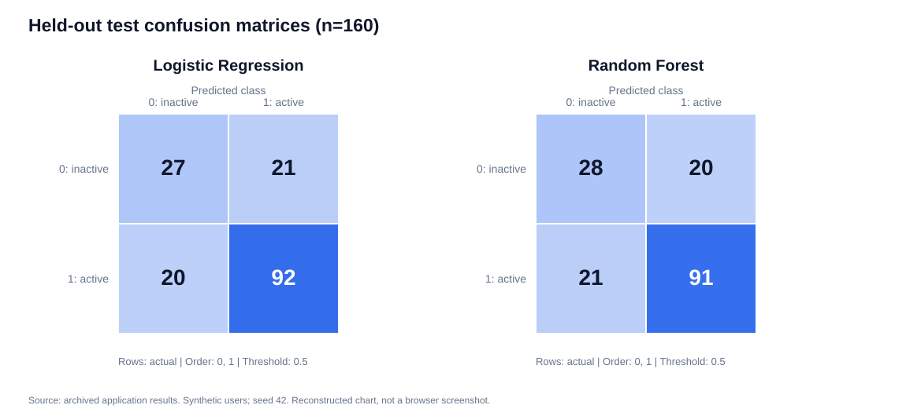
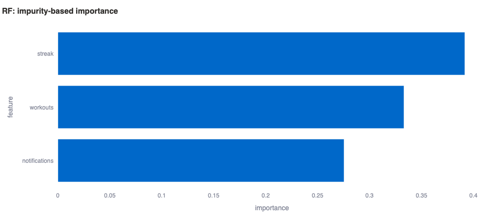
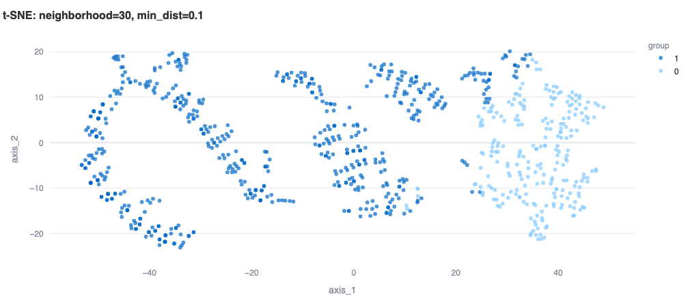
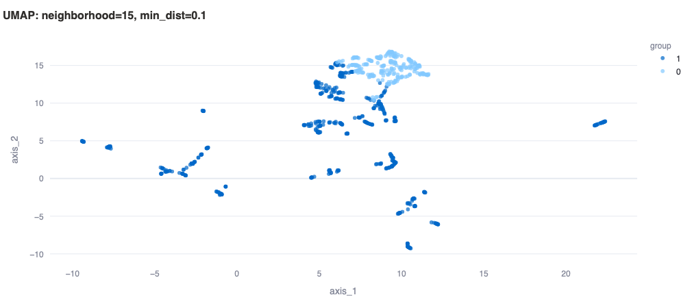

# Fitness Retention Lab — Variant 28

**Author:** Bakhtiyar Makashev Sagandykovich  
**Course:** AI Fundamentals  
**Project:** Fitness app retention  
**Language:** English

A Streamlit application that combines next-week activity prediction, exploratory user segmentation, dimensionality reduction, and anomaly detection in one interface.

> All 800 observations and all target labels in the reported experiment are synthetic. The metrics are actual outputs of the application on this simulation. They are not evidence of performance on a real fitness platform.

## 1. Problem and practical purpose

The supervised question is: **Will a user complete at least one workout next week?** The unsupervised question is: **Which behavioral groups, low-dimensional patterns, and unusual observations can be identified without using next-week activity labels?**

A product team could use such a workflow to prioritize retention experiments, describe engagement segments, and investigate unusual records. The project demonstrates these analytical tools; it does not claim that notifications cause retention or that any proposed campaign has already improved business outcomes.

| AI topic | Implementation | Outputs |
| --- | --- | --- |
| Supervised learning | Logistic Regression and Random Forest, median imputation and scaling inside pipelines | Identical 3-fold training CV; test precision, recall, F1, accuracy, ROC-AUC; confusion matrices; interpretation; new-user predictions |
| Unsupervised learning | K-Means, DBSCAN, PCA, t-SNE, UMAP | K search, cluster profiles, seed stability, density sensitivity, explained variance, nonlinear maps |
| Anomaly detection | Isolation Forest at several contamination settings | Flag counts, anomaly scores, overlap and disagreement with DBSCAN noise |

## 2. Dataset and provenance

The original generator is implemented in `app.py` as `generate_data`. It creates 600–1,000 independent user records; this report uses **800 users, seed 42, and a 0.05 missing-value probability per feature**. A user appears once, at the end of a simulated week.

| Column | Definition | Role |
| --- | --- | --- |
| `user_id` | Synthetic unique identifier | Audit only; excluded from model inputs |
| `workouts` | Workouts completed in the past seven days; generator range 0–14 | Numerical feature |
| `streak` | Consecutive days of app activity as of the current week; generator range 0–120 | Numerical feature |
| `notifications` | Push notifications received in the past seven days; generator range 0–60 | Numerical feature |
| `active_next_week` | At least one workout in the next week: 1=yes, 0=no | Supervised target only |

App activity in a streak can include activity other than workouts. Therefore, zero workouts with a positive streak is not automatically inconsistent.

Three overlapping engagement regimes control Poisson workout/notification counts and Gamma-distributed streaks. They are internal generator assumptions, not stored ground-truth segment labels. Unusual feature combinations are inserted into 3% of rows. The next-week label is sampled from a Bernoulli distribution whose probability depends on a noisy nonlinear logistic function of the features. Labels are not independent random guesses, but they are simulated outcomes. See [the exported assumptions](evidence/assumptions_and_limitations.md) for the full equation.

Missing feature values are inserted after label generation using independent MCAR masking. The observed counts are 40 missing workouts (5.00%), 30 missing streaks (3.75%), and 29 missing notification counts (3.625%): 99 of 2,400 feature cells, or 4.125%. Realized missingness need not equal its configured probability. No target labels are missing. The classes are 560 active users (70%) and 240 inactive users (30%). No real personal information is included.

The OpenML catalog mentioned in the assignment is a possible starting point, **not the source of this generated dataset**.

## 3. Installation and launch

Place `app.py` and `requirements.txt` in the same project directory. No API keys, accounts, or external dataset download are required at runtime. Internet access is needed when installing dependencies.

Python 3.11 or 3.12 is a conservative setup choice for a fresh installation. The submitted run itself recorded Python 3.14.6; use the recorded package versions when investigating differences rather than assuming identical results across environments.

### macOS / Linux

```bash
python3 -m venv .venv
source .venv/bin/activate
python -m pip install -r requirements.txt
streamlit run app.py
```

Equivalent launch command:

```bash
python -m streamlit run app.py
```

### Windows PowerShell

```powershell
py -m venv .venv
.venv\Scripts\Activate.ps1
python -m pip install -r requirements.txt
python -m streamlit run app.py
```

Open the local URL printed in the terminal, usually `http://localhost:8501`. Keep the terminal process running. Stop it with `Ctrl+C`.

## 4. Application guide

| Sidebar page | What to inspect |
| --- | --- |
| 1 · Data and EDA | Provenance, feature dictionary, training-only histograms, class balance, missingness |
| 2 · Supervised | CV selection, final test tables, confusion matrices, ROC curves, coefficients/importance, error costs |
| 3 · Clustering | K=2…8 search, profiles, seed stability, DBSCAN sensitivity, preprocessing comparisons |
| 4 · PCA / t-SNE / UMAP | PCA variance/loadings; enable the checkbox to compute two settings of each nonlinear method |
| 5 · Anomaly detection | Contamination sensitivity, DBSCAN comparison, anomalous rows and scores |
| 6 · New user prediction | Sliders and explicit unknown-value checkboxes; submit using Predict |
| 7 · Export and limitations | Build results ZIP, then download the archive |

Keep **800 users, seed 42, and missingness 0.05** to match this report. The ZIP exporter uses K selected by silhouette, DBSCAN `eps=0.7`, `min_samples=5`, and Isolation Forest `contamination=0.05`. Export settings can differ from settings selected on another page. The current app exporter does not save t-SNE/UMAP coordinates or feature-importance values. This completed package supplements it with direct application PNGs and executed notebook outputs containing those numerical results.

## 5. Methodology and leakage control

The supervised data are split **80/20 before any fitted preprocessing**, with stratification and seed 42: 640 training users and 160 test users. Both candidates use `SimpleImputer(strategy="median") → StandardScaler → classifier` inside `Pipeline`. The same three stratified CV folds are applied to training rows. Mean positive-class F1 selects the model; the test set is evaluated after that selection. Scaling is useful for Logistic Regression and retained for a uniform workflow with Random Forest, although trees do not generally need it.

The exploratory branch uses a separate preprocessing fit on all 800 users. Only the three explicitly listed features are supplied to K-Means, DBSCAN, projections, and Isolation Forest. Neither the target nor `user_id` is used. Clusters are fitted in standardized 3D feature space, not on the 2D maps. Full-cohort exploratory analysis is not an independent test of generalization.

The business threshold tool uses training out-of-fold predictions. Its optimized OOF cost is not an unbiased estimate of deployed cost. The principal reported test metrics use threshold 0.5. Do not alter seeds or select models based on repeated inspection of test results.

## 6. Observed supervised results

| Model | Training CV F1 mean ± SD | Test accuracy | Test precision | Test recall | Test F1 | Test ROC-AUC |
| --- | --- | --- | --- | --- | --- | --- |
| Logistic Regression | 0.8391 ± 0.0127 | 0.7438 | 0.8142 | 0.8214 | 0.8178 | 0.7975 |
| Random Forest | 0.8356 ± 0.0146 | 0.7438 | 0.8198 | 0.8125 | 0.8161 | 0.7810 |
| Majority baseline | Not used in candidate selection | 0.7000 | 0.7000 | 1.0000 | 0.8235 | 0.5000 |

**Selected model: Logistic Regression**, by training CV F1. Its confusion matrix is `[[27, 21], [20, 92]]`, with actual classes as rows and predicted classes as columns, ordered 0 then 1.



A necessary qualification is that both trained classifiers have slightly lower positive-class test F1 than the majority baseline. The baseline predicts every user as active, so it never identifies inactive users. Logistic Regression improves accuracy by 4.375 percentage points and has ROC-AUC 0.7975, but it does **not** outperform the baseline on every metric. Its macro F1 is 0.6931 versus 0.4118 for the baseline. Baseline comparisons show why the business objective and positive class must be explicit.

## 7. Observed unsupervised and anomaly results

| Result | Observed value |
| --- | --- |
| K selected by maximum standardized silhouette | 2 |
| K=2 silhouette | 0.4457 |
| K=2 inertia | 1537.9423 |
| Cluster sizes | 236 users and 564 users |
| ARI versus reference, seeds 0, 1, 2, 3, 4, 42 | 1.0000 for every run |
| DBSCAN, eps=0.7 / min_samples=5 | 1 cluster, 42 noise points (5.25%) |
| First two PCA components | 81.1137% of standardized variance |
| Isolation Forest, contamination=0.05 | 40 flagged users |
| IF/DBSCAN shared flags | 34 users; Jaccard=0.7083 |

| Exploratory segment | Users | Mean workouts | Mean streak | Mean notifications |
| --- | --- | --- | --- | --- |
| Cluster 0: higher engagement | 236 | 5.99 | 20.72 | 5.56 |
| Cluster 1: lower engagement, more notifications | 564 | 1.52 | 3.50 | 11.70 |

These names describe observed input profiles; they are not verified retention labels. Means use non-missing original values. Higher notification frequency in one segment does not prove that notifications reduce engagement.

## 8. Functionality and validation evidence

The browser demonstration verified classification output, cluster profiles, nonlinear projections, anomaly comparison, ordinary prediction, prediction with all three inputs missing, and successful ZIP download. This is a manual functional check, not a full automated test suite or a performance benchmark. The default new-user example (3 workouts, streak 7, 8 notifications) displayed about 83.2% predicted activity probability; the all-missing example displayed about 68.8% using training medians. These probabilities are uncalibrated simulation outputs.

For this documentation package, the exported dataset hash was checked against the manifest; the row counts, class counts, split membership, confusion matrices, and reported classification metrics were independently checked from the saved CSVs. No model was retrained to improve a reported score.

## 9. Files and submission materials

| Path | Purpose |
| --- | --- |
| `app.py` | Complete English Streamlit application |
| `requirements.txt` | Direct installation dependencies |
| `README.md` | This documentation |
| `reports/Supervised_Learning_Report.md` | Full first report and worksheet answers |
| `reports/Unsupervised_Learning_Report.md` | Full second report and worksheet answers |
| `defense/Presentation_Plan.md` | 12 slides, speaker notes, exact screenshot instructions |
| `figures/` | Reconstructed archived-data charts plus three direct PNG exports from the running application |
| `notebooks/` | Two standalone `.ipynb` notebooks with locally executed outputs |
| `supervised_outputs/` | Newly executed CV/test/coefficients/RF-importance tables |
| `unsupervised_outputs/` | Newly executed combined summary, projection diagnostics, and all four embedding coordinate files |
| `evidence/` | Original exported CSV/JSON/HTML evidence and a documented LR coefficient reconstruction |

The original worksheets require executable notebooks. This completed package now includes both standalone notebooks with executed cells and outputs. The presentation file is a complete slide plan and speaking script, not a rendered PowerPoint deck. The source repository is [bahti2009-droid/fitness-retention-variant28](https://github.com/bahti2009-droid/fitness-retention-variant28). The application itself is demonstrated locally; this repository does not claim a publicly deployed Streamlit server.

## Standalone Google Colab notebooks

- [Supervised Learning notebook](notebooks/Fitness_Retention_Supervised.ipynb)
- [Unsupervised Learning and Anomalies notebook](notebooks/Fitness_Retention_Unsupervised.ipynb)

[Open Supervised in Colab](https://colab.research.google.com/github/bahti2009-droid/fitness-retention-variant28/blob/main/notebooks/Fitness_Retention_Supervised.ipynb)

[Open Unsupervised in Colab](https://colab.research.google.com/github/bahti2009-droid/fitness-retention-variant28/blob/main/notebooks/Fitness_Retention_Unsupervised.ipynb)

Both notebooks embed the exact archived synthetic CSV and verify its SHA-256. They include the original generator for transparency, but train and analyze the embedded table to preserve the reported experiment. They do not import Streamlit, need a running server, or require a separate dataset upload. Each follows 12 methodological steps, includes worksheet answers, and contains 13 executed code cells.

To use Google Colab, open [Colab](https://colab.research.google.com/), select **File → Upload notebook**, choose the `.ipynb`, and select **Runtime → Run all**. Initial dependency installation may require internet access. Plotly outputs are interactive in compatible viewers. The notebook installation cell only installs missing libraries. The file links above point to the included notebooks. The verified GitHub-backed Colab entry points below open those notebooks directly. Saving a personal Drive copy is optional unless your instructor specifically requires a Drive-hosted document URL.

The saved outputs were produced by actual sequential local Python execution in the project's installed environment, capturing stdout and rich displays. They were not executed on Google's infrastructure. Selected-model F1/AUC, the default DBSCAN noise count, PCA variance, IF overlap, and all four projection trustworthiness values match the archived/application experiment. The app PNGs are also embedded as static rich outputs for the corresponding notebook charts. `evidence/notebook_execution.json` records the local execution outcome.

### Newly included application charts







These are direct PNG downloads from the application's chart controls. They preserve the real displayed plots rather than synthesized illustrations. The t-SNE title's generic `min_dist` field is a UI label artifact and does not represent a t-SNE parameter.

## 10. Limits and next improvements

Results are conditional on a designed simulation. There are no independently verified real anomalies, real retention outcomes, campaign effects, or externally validated segments. The small CV difference does not establish statistically significant superiority. Seed stability covers initialization, not new samples. Raw/scaled silhouettes describe different geometries. Probability calibration, temporal validation, grouped splitting, and randomized campaign evaluation are appropriate next steps before any real use.

The application should support an analyst's review rather than automatically block users or send campaigns. For a real platform, obtain consent, minimize retained data, respect notification preferences, and validate error costs with stakeholders.

## 11. Reproducibility

The exported environment was Python **3.14.6**, NumPy **2.5.5**, pandas **2.3.3**, scikit-learn **1.9.1**, Streamlit **1.67.0**, Plotly **6.9.0**, and umap-learn **0.5.12**. Direct dependency ranges are kept in `requirements.txt`; they are not a complete environment lock. Save a full environment with `python -m pip freeze > environment-lock.txt` after a successful installation when exact dependency tracking is needed.

Dataset SHA-256, computed on `fitness_SYNTHETIC.csv` exactly as exported:

```text
d0526e53c4a5929c8808f73065a2c8cd1eedb00146d18171a476dfe29f0369ed
```

Use the saved dataset and split membership for audit. Matching seeds helps within a fixed implementation and environment; it does not guarantee bit-identical results across future package versions or hardware.

## References

1. Course handout: *Practice 8 — Final Project Worksheet*, Variant 28, supplied by the student.
2. Course handout: *Final Project — Unsupervised Learning*, Variant 28, supplied by the student.
3. [scikit-learn: Cross-validation](https://scikit-learn.org/stable/modules/cross_validation.html).
4. [scikit-learn: Clustering](https://scikit-learn.org/stable/modules/clustering.html).
5. [scikit-learn: Novelty and Outlier Detection](https://scikit-learn.org/stable/modules/outlier_detection.html).
6. [UMAP: Reproducibility](https://umap-learn.readthedocs.io/en/latest/reproducibility.html).
7. [Streamlit documentation](https://docs.streamlit.io/).
