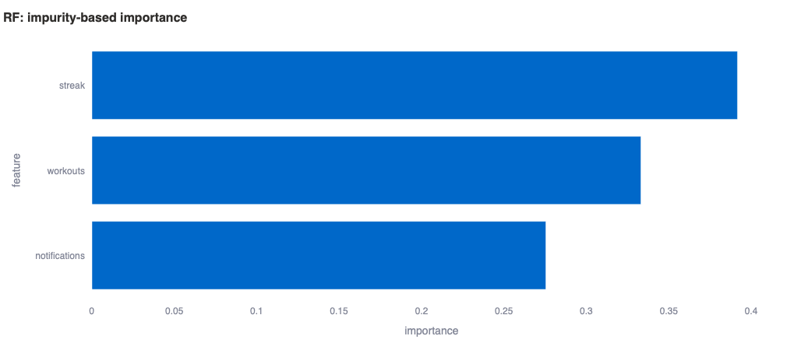
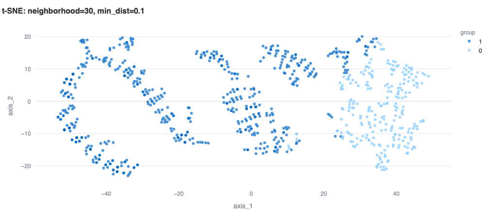
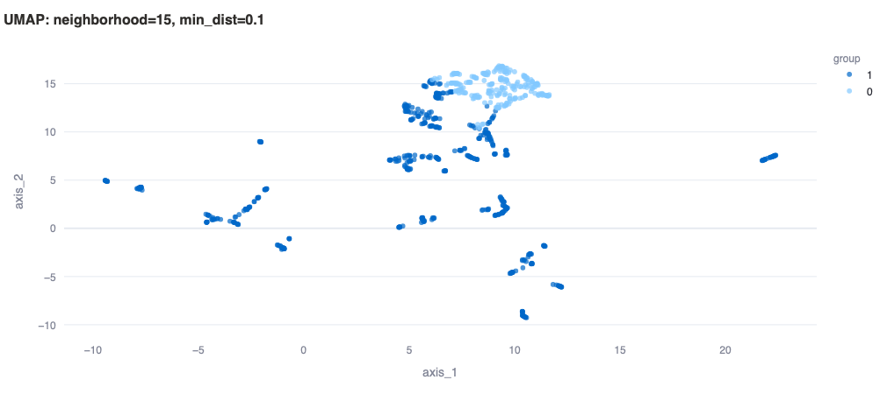

# Fitness Retention Lab — 12-Slide Defense Plan

**Student:** Bakhtiyar Makashev Sagandykovich  
**Course:** AI Fundamentals · Variant 28  
**Suggested duration:** about 8 minutes, excluding questions  
**Format:** slide-ready bullet text, speaking notes, and exact visual instructions. This is a presentation plan, not an exported slide deck.

## Before preparing the slides

Keep all application screenshots from the same experiment: **800 users, seed 42, missing-value probability 0.05**. Use K=2, DBSCAN eps=0.7/min_samples=5, and IF contamination=0.05 unless the slide explicitly shows sensitivity. Crop charts to keep titles, axes, legends, and relevant settings visible. Avoid unrelated browser tabs or private information. Use no more than two primary visuals on a slide, except the deliberately compact three-map comparison on Slide 10.

The package now includes direct PNG exports of RF importance, t-SNE, and UMAP from the running application. The images are embedded below in Slides 7 and 10. Saved HTML graphs and reconstructed SVGs support the remaining slides. The two standalone notebooks include executed outputs on the exact archived data. All results describe synthetic data.

## Slide 1 — Fitness Retention Lab

**Time:** 20 seconds.

**On-slide text**

- Variant 28: Fitness app retention
- Prediction, segmentation, and anomaly detection in one application
- Bakhtiyar Makashev Sagandykovich · AI Fundamentals
- 800 synthetic users; reproducible experiment

**Speaker notes**

“Hello everyone. My project is Fitness Retention Lab. It combines three AI topics in one Streamlit application: predicting next-week activity, exploring user groups, and detecting unusual observations. All data and labels are synthetic, and the results shown today come from an actual application run.”

**Visual to insert:** A cropped screenshot of the application heading and sidebar with Users=800, seed=42, and missingness=0.05. Keep the synthetic-data notice visible. Do not present a local URL as a public deployment.

## Slide 2 — Problem, data, and intended value

**Time:** 35 seconds.

**On-slide text**

- Object: one user at the end of a week
- Inputs: workouts, streak, received notifications
- Supervised target: at least one workout next week (1=yes)
- 560 active users; 240 inactive users
- Goal: support retention experiments and analyst review

**Speaker notes**

“The target is next-week activity, so class one means active, not churn. The inputs are measured before that target week. Each simulated user appears once. The application could support retention analysis, but this experiment does not measure a real business effect. The data generator's assumptions must be distinguished from real user behavior.”

**Visual to insert:** `1 · Data and EDA → Data and provenance`: feature dictionary plus the 800-user and 70%-active summary. An alternative is a compact feature/target table created from the README.

## Slide 3 — Data quality and honest simulation

**Time:** 40 seconds.

**On-slide text**

- Labels depend on a noisy nonlinear activity function
- 99 missing feature cells (4.125%)
- Missing values: workouts 40; streak 30; notifications 29
- Right-skewed distributions and unusual combinations
- Median imputation; original data preserved

**Speaker notes**

“The labels are simulated but not independent random guesses. Their probabilities depend on the features and unobserved noise. Missing values are inserted afterward under an MCAR assumption. The configured missing probability is five percent, while the realized missing rate is 4.125 percent. Streak has a long tail, so a median is a sensible imputation baseline. These simplifications are documented.”

**Visual to insert:** A compact panel of `figures/train_workouts.svg`, `train_streak.svg`, and `train_notifications.svg`, or the three matching train histograms from `1 · Data and EDA → EDA`. Label the panels “Training subset, n=640.”

## Slide 4 — Supervised workflow without leakage

**Time:** 40 seconds.

**On-slide text**

- Stratified 80/20 split: 640 training / 160 test users
- Pipeline: median imputer → scaler → classifier
- Same three stratified CV folds for both candidates
- Model selection: mean training CV F1
- Test evaluated after the choice is fixed

**Speaker notes**

“I split before fitting any preprocessing. During cross-validation, every fold fits its own imputer, scaler, and classifier. Logistic Regression and Random Forest use identical folds. The model is selected by mean CV F1 on training users. Test results are not used to choose a model. A separate exploratory pipeline handles the unsupervised analysis.”

**Visual to insert:** `2 · Supervised → CV and model selection`: pipeline summary and CV chart. `figures/cv_comparison.svg` is a clean alternative.

## Slide 5 — Model comparison and the baseline caveat

**Time:** 50 seconds.

**On-slide text**

| Model | CV F1 | Test accuracy | Test F1 | ROC-AUC |
| --- | --- | --- | --- | --- |
| Logistic Regression | 0.8391 | 0.7438 | 0.8178 | 0.7975 |
| Random Forest | 0.8356 | 0.7438 | 0.8161 | 0.7810 |
| Always-active baseline | — | 0.7000 | 0.8235 | 0.5000 |

- Logistic Regression selected by CV
- The baseline has slightly higher positive-class test F1
- It never identifies an inactive user

**Speaker notes**

“Logistic Regression wins the predefined CV comparison, although the difference is small. A key limitation is that the all-active baseline has slightly higher test F1. With seventy percent active users, predicting everybody active gives perfect activity recall. It gives zero inactive-user recall. Our model improves accuracy and probability ranking, but I do not claim that it beats the baseline on every metric.”

**Visual to insert:** `2 · Supervised → Final test evaluation`: the complete table including the majority baseline. Optionally use `figures/roc_curves.svg` beside a shortened table.

## Slide 6 — Errors and practical decisions

**Time:** 45 seconds.

**On-slide text**

- Logistic Regression matrix: TN=27, FP=21, FN=20, TP=92
- FP: predicted active, actually inactive → missed retention opportunity
- FN: predicted inactive, actually active → unnecessary outreach
- Illustrative FP/FN costs: 5/1 → 0.78125 units per user
- Tune thresholds using training OOF predictions, never the test set

**Speaker notes**

“The direction of business errors follows our activity target. A false positive is an inactive user whom the model expects to stay active. That could mean missing an opportunity to help. A false negative could lead to unnecessary messages. The five-to-one cost scenario is illustrative, not measured money. Raising the activity threshold predicts fewer active users and can reduce false positives at the cost of more false negatives.”

**Visual to insert:** `2 · Supervised → Final test evaluation → Logistic Regression` confusion matrix, or the left panel of `figures/supervised_confusion_matrices.svg`. If showing the Error costs page, explicitly distinguish threshold 0.5 results from the OOF-selected threshold.

## Slide 7 — Interpreting the model and showing the UI

**Time:** 40 seconds.

**On-slide text**

- Standardized LR coefficients: streak +1.520; workouts +1.162; notifications −0.246
- Associations are not causal effects
- RF split importance gives no effect direction
- Sliders accept known values and explicit missing inputs
- Example (3, 7, 8): about 83.2% predicted activity

**Speaker notes**

“Streak has the largest absolute standardized logistic coefficient in this fitted model, followed by workouts. Notifications have a smaller negative coefficient. These values describe the simulated associations and do not mean that sending fewer notifications would cause higher retention. The interface also handles missing inputs. The example prediction is a demonstration, not an independent validation. With all inputs missing, it predicts for the training median profile.”

**Visual to insert:** `2 · Supervised → Interpretation`: the `LR: standardized coefficients` and `RF: impurity-based importance` charts. `figures/lr_coefficients.svg` reproduces LR values recovered from saved probabilities. The actual app PNG is embedded below. The executed supervised notebook additionally exports its numerical importance vector (streak 0.3916, workouts 0.3330, notifications 0.2754). A small optional inset can show `6 · New user prediction` after submitting (3,7,8).

## Slide 8 — Choosing K and checking stability

**Time:** 45 seconds.

**On-slide text**

- Evaluate K=2…8 in standardized feature space
- Highest silhouette: K=2, score 0.4457
- Inertia=1537.9423
- Elbow is not uniquely at K=2; K=4 is another interpretable candidate to investigate
- Seeds 0,1,2,3,4,42: ARI=1.0

**Speaker notes**

“K-Means was fitted in the original standardized three-feature space, not on a projection. K equals two gives the highest silhouette and a simple coarse description. The inertia curve keeps declining and does not prove that two is the true number of groups. The assignments are identical across the tested initialization seeds, but that only checks initialization stability on this cohort, not generalization to new users.”

**Visual to insert:** `3 · Clustering → K-Means`: Elbow and Silhouette charts side by side, or `figures/k_selection.svg`. Show the seed table as a small inset or state ARI in text.

## Slide 9 — User profiles and DBSCAN sensitivity

**Time:** 45 seconds.

**On-slide text**

| Segment | Users | Workouts | Streak | Notifications |
| --- | --- | --- | --- | --- |
| Higher engagement | 236 | 5.99 | 20.72 | 5.56 |
| Lower engagement | 564 | 1.52 | 3.50 | 11.70 |

- DBSCAN default: one cluster + 42 noise users
- Tested settings: 1–9 clusters, 8–133 noise users
- Proposed interventions remain hypotheses

**Speaker notes**

“These names summarize observed behavior, not actual churn labels. The lower-engagement group receives more notifications, but that is not causal evidence. DBSCAN gives a different view: at the default setting it finds one dense region and forty-two sparse users. Its results change considerably across settings. K-Means must partition all users, whereas DBSCAN can leave noise unassigned.”

**Visual to insert:** The profile table from `3 · Clustering → K-Means`, or `figures/cluster_profiles.svg`, together with a compact crop of `3 · Clustering → DBSCAN` sensitivity rows. Keep default eps=0.7/min_samples=5 visible. Default silhouette is undefined because there is only one non-noise cluster.

## Slide 10 — PCA, t-SNE, and UMAP

**Time:** 50 seconds.

**On-slide text**

- PCA: first two components retain 81.11% of variance
- t-SNE: perplexity 30 and 10
- UMAP: neighbors 15 and 30, min_dist 0.1
- Trustworthiness(k=10): t-SNE ≈0.995–0.996; UMAP ≈0.987–0.991
- Maps visualize structure; they do not independently validate segments

**Speaker notes**

“PCA gives quantified variance retention and interpretable linear directions. The nonlinear methods emphasize local neighborhoods. Their trustworthiness values were observed in the application and reproduced in the executed notebook. The new diagnostic CSV preserves them. These high values describe neighborhood preservation, not cluster accuracy. Colors are the same K-Means labels on each map. Distances between visual islands and their sizes should not be treated as faithful measurements.”

**Visual to insert:** Three equal-size maps from `4 · PCA / t-SNE / UMAP`: PCA, `t-SNE: neighborhood=30, min_dist=0.1`, and `UMAP: neighborhood=15, min_dist=0.1`. Enable the compute checkbox first. The t-SNE title's generic min_dist field is not a t-SNE setting; label that panel simply “t-SNE, perplexity=30.” The existing `pca.html` or `figures/pca_clusters.svg` can supply the PCA panel. The actual application PNG exports are embedded below. Notebook outputs additionally preserve their coordinate data.

## Slide 11 — Anomaly detection and agreement

**Time:** 40 seconds.

**On-slide text**

- Isolation Forest flags: 16 at 2%, 40 at 5%, 80 at 10%
- At 5%: 34 shared flags, 6 IF-only, 8 DBSCAN-only
- Jaccard overlap: 0.7083
- Flag ≠ confirmed error, fraud, or churn
- Check source records and plausible explanations before acting

**Speaker notes**

“Changing contamination changes the threshold and expected flag count; it does not measure the true anomaly rate. Isolation Forest and DBSCAN agree on thirty-four users and disagree on fourteen. Agreement suggests cases worth reviewing, but there is no ground-truth anomaly label. A flagged user could represent a logging issue, an unusual notification policy, or valid behavior.”

**Visual to insert:** `5 · Anomaly detection`, contamination=0.05, eps=0.7, min_samples=5: the overlap table and `Agreement between methods in PCA`. `figures/anomaly_agreement.svg` reproduces the archived comparison.

## Slide 12 — Conclusions, limitations, and next steps

**Time:** 35 seconds.

**On-slide text**

- One working English interface for three AI topics
- Reproducible outputs and transparent baseline comparison
- Two interpretable exploratory groups; complementary anomaly views
- Limits: synthetic data, sensitive settings, no causal or deployment validation
- Next: real consented logs, temporal/grouped evaluation, calibration, A/B testing

**Speaker notes**

“The main contribution is a complete, reproducible analytical workflow rather than a claim of perfect prediction. I explicitly report the baseline limitation and the difference between algorithmic flags and verified anomalies. The next step would be real consented logs and independent temporal validation, followed by an experiment to test whether any intervention actually improves retention. Thank you.”

**Visual to insert:** The application sidebar and export page, or a compact evidence table showing test AUC, K=2 silhouette, PCA variance, and 34 shared anomaly flags. Add small references to the two course worksheets, scikit-learn documentation, and UMAP documentation.

## Short live demonstration (optional, after the slides)

1. Show fixed experiment settings.
2. Open CV selection, then the test table with the baseline included.
3. Predict (3 workouts, streak 7, 8 notifications).
4. Mark all inputs unknown and predict again; explain median imputation.
5. Show K=2 profiles, default DBSCAN, and the anomaly agreement plot.
6. Open precomputed PCA/t-SNE/UMAP maps. Avoid a cold first UMAP compilation during a time-limited defense.
7. Show the export command and the generated results archive.

## Likely defense questions and concise answers

| Question | Suggested spoken answer |
| --- | --- |
| Are these real users? | No. Inputs and outcomes are explicitly synthetic; measured performance applies only to this simulation. |
| Why is the target not churn? | The assigned target is activity next week. Churn-like inactivity is class zero, so error names must follow that coding. |
| Why Logistic Regression? | It has the higher mean training CV F1 under the predefined rule. The difference is small and not proof of universal superiority. |
| Why does the dummy baseline have higher F1? | Positive prevalence is 70%, so always predicting activity gets perfect positive recall. It cannot identify inactive users and has AUC 0.5. |
| Did you preprocess before splitting? | No. Each training fold fits the whole pipeline. The exploratory branch has a separate fit and excludes the target. |
| Why scale Random Forest? | It is kept for a uniform pipeline; tree splits generally do not require scaling. |
| Why K=2 if there is no clear elbow at two? | It maximizes silhouette and gives simple profiles. The elbow is complementary evidence, not confirmation of a true K. |
| Why is DBSCAN silhouette blank? | At the default, there is only one non-noise cluster. Standard silhouette is undefined. |
| Does ARI=1 prove real segments? | No. It shows identical partitions across tested initializations on this dataset, not robustness to new samples. |
| Does UMAP separation validate K-Means? | No. The maps use K-Means colors and distort geometry. They are supporting visualizations. |
| Does 5% contamination mean 5% true anomalies? | No. It sets an algorithmic threshold; no verified anomaly labels are available. |
| Which business error is more expensive? | It depends on validated costs. A false positive here is missed inactivity; the 5-to-1 example is an assumption. |
| Does the negative notification coefficient justify fewer messages? | No. It is a conditional association in simulated data. An A/B test is needed to evaluate a causal intervention. |
| Have all LMS submission files been produced? | The app, two report texts, defense plan, and two executed standalone notebooks are included. The notebooks can be uploaded to Colab. Public sharing links and a GitHub repository still need their actual account destinations. |

## Requirement-to-evidence mapping

| LMS criterion supplied by the student | Evidence to show | Boundary of the claim |
| --- | --- | --- |
| Correct implementation of three AI topics (30) | Slides 4–11 and live app | No guarantee of the examiner's score |
| Functionality and stability (20) | Bounded inputs, missingness handling, successful nonlinear maps/export | Manual demonstration is not exhaustive testing |
| Testing and results (15) | CV, test metrics, baseline, matrices, sensitivity, anomaly overlap | No fabricated performance or unrun automated tests |
| UI/UX (10) | English sidebar, tabs, sliders, live plots | Demonstrated locally; no public deployment claimed |
| Code, GitHub, documentation (10) | `app.py`, dependencies, README, evidence files | A repository still needs actual upload; no GitHub URL is invented |
| Originality and practical value (5) | Integrated fitness use case, error-cost scenario, segment hypotheses | No untested business uplift claim |
| Defense materials (10) | This 12-slide plan, notes, figure instructions, Q&A | This is a plan, not a rendered PowerPoint file |
