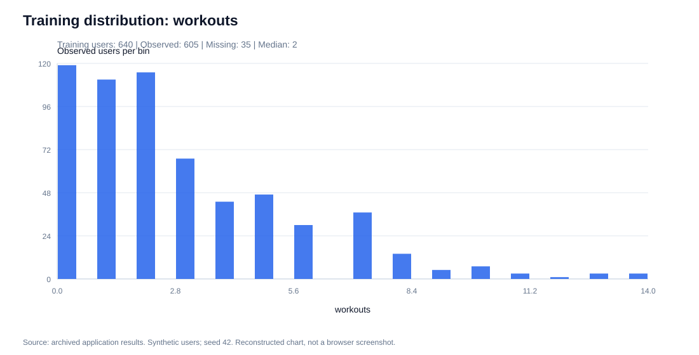
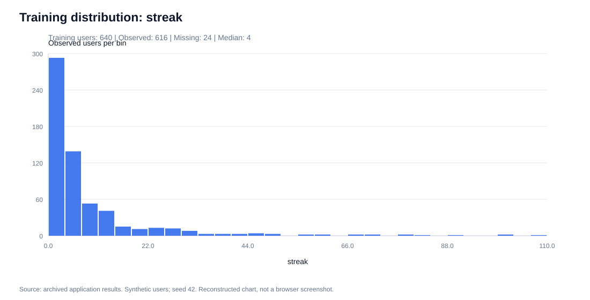
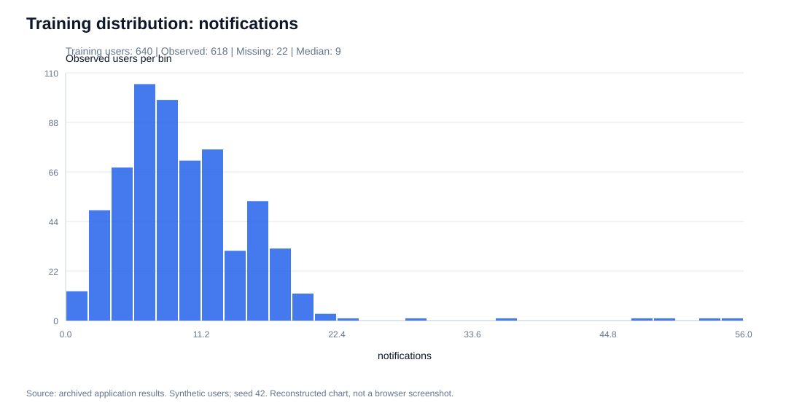
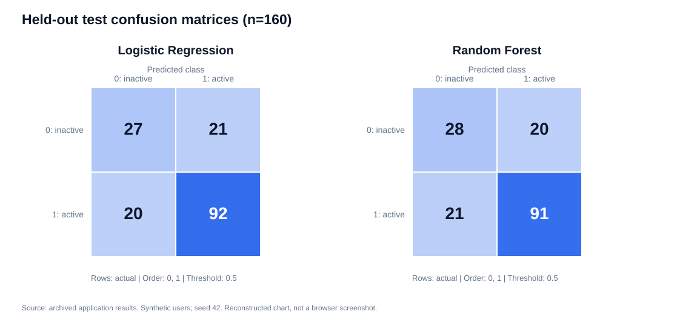
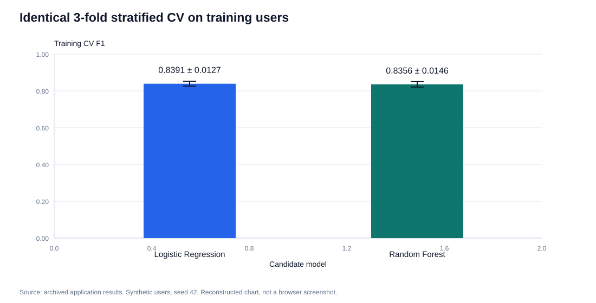
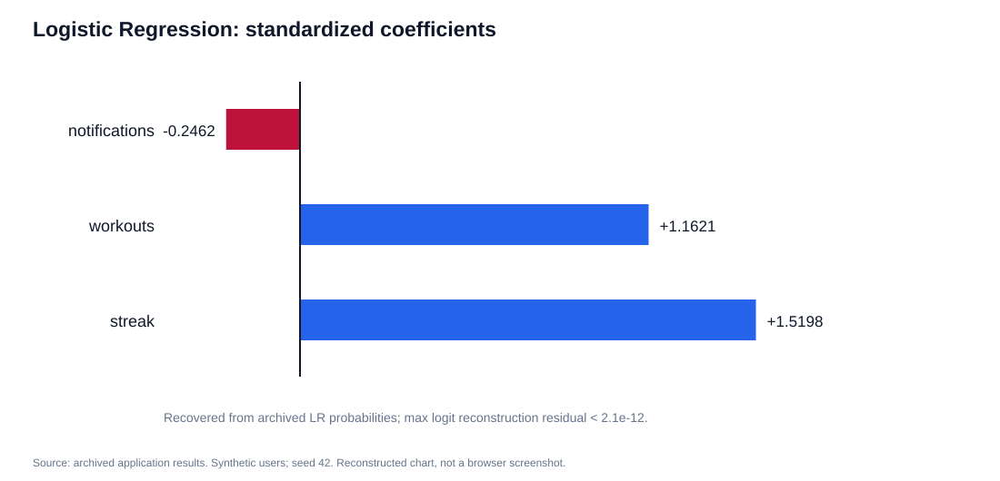
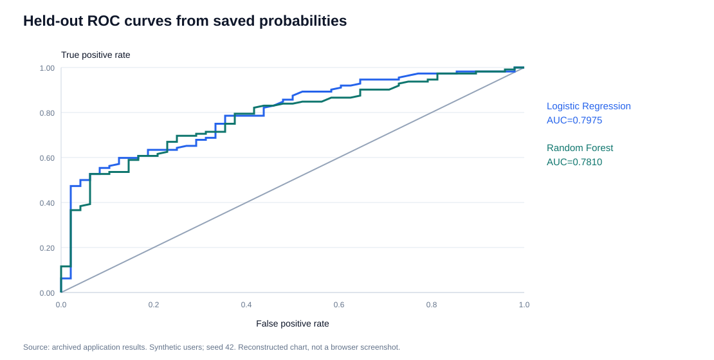
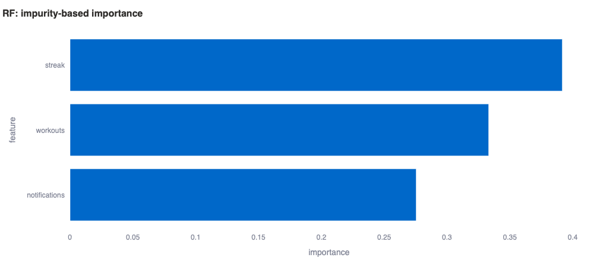

# Practice 8 — Supervised Learning Report

## Variant 28: Fitness App Retention

**Student:** Bakhtiyar Makashev Sagandykovich  
**Course:** AI Fundamentals  
**Experiment:** 800 synthetic users; seed 42; feature missingness probability 0.05  
**Evidence:** the application's exported `fitness_results_SYNTHETIC.zip`, supported by the observed browser demonstration.

## Abstract

This study predicts whether a simulated fitness-app user will complete at least one workout next week. Logistic Regression and Random Forest were compared using identical stratified three-fold cross-validation on 640 training users. Median imputation and standardization were fitted inside each pipeline. Logistic Regression was selected by mean validation F1 of 0.8391, compared with 0.8356 for Random Forest. On 160 held-out users, the selected model achieved accuracy 0.7438, precision 0.8142, recall 0.8214, F1 0.8178, and ROC-AUC 0.7975. A majority-class baseline achieved a slightly higher positive-class F1 of 0.8235, but classified every inactive user incorrectly. The results demonstrate a functioning analytical system and illustrate trade-offs between metrics; they do not validate retention prediction for real users.

## Step 1 — Libraries, task definition, and research object

The system uses NumPy and pandas for data handling, scikit-learn for learning and evaluation, Plotly for interactive charts, and Streamlit for its web interface. The object of research is engagement with a fitness application. The observation unit is one unique user at the end of a single simulated week.

The target `active_next_week` equals 1 if the simulated user completes at least one workout during the next week and 0 otherwise. Thus **the positive class is activity, not churn**. All three inputs describe behavior before the target week:

| Feature | Meaning | Units and allowed range |
| --- | --- | --- |
| `workouts` | Workouts during the past seven days | Count, 0–14 |
| `streak` | Consecutive days of app activity ending in the current week | Days, 0–120 |
| `notifications` | Push notifications received during the past seven days | Count, 0–60 |

`user_id` is retained for auditing but is not a predictor. No future-week behavior or target-derived field is included in the inputs. No feature engineering is applied to the classifier inputs; the nonlinear transformations described below belong to the data generator, not the trained Logistic Regression model.

## Step 2 — Dataset source, generation, and inspection

The dataset is an original **synthetic simulation**. The assignment's OpenML catalog link does not establish a dataset containing these exact features and target. This project therefore uses the explicitly synthetic option allowed by the worksheet. Neither the observations nor the labels are described as real-world measurements.

Three overlapping internal engagement regimes determine Poisson-distributed workout counts, Gamma-distributed streaks, and Poisson-distributed notification counts. Regime IDs are discarded. Unusual combinations are inserted into 3% of observations, without creating a ground-truth anomaly label. The generator defines a logit:

```text
z = -2 + 0.55*workouts + 0.9*log(1 + streak)
    + 0.07*min(notifications, 10)
    - 0.06*max(notifications - 10, 0)
    - 0.10*max(workouts - 9, 0)^2 + Normal(0, 0.75)
p = 1 / (1 + exp(-z))
active_next_week ~ Bernoulli(p)
```

The equation encodes assumed associations, diminishing notification benefits, a possible high-volume penalty, and unobserved influences. These assumptions make the exercise meaningful while preserving uncertainty. They are not empirical evidence about fitness users. Missing feature readings are independently masked after label generation under an MCAR assumption. The original table is preserved.

| Data item | Observed value |
| --- | --- |
| Rows / numerical predictors | 800 / 3 |
| Active / inactive users | 560 / 240 (70% / 30%) |
| Missing workouts | 40 (5.00%) |
| Missing streak | 30 (3.75%) |
| Missing notifications | 29 (3.625%) |
| Total missing predictor cells | 99 / 2,400 (4.125%) |
| Target missingness | 0 |

The realized missing rate differs from the configured probability because masking is random. Missing values are not zeros: a missing workout count is different from an observed zero workouts.

## Step 3 — Exploratory analysis and at least three feature plots

Classification EDA uses only the training subset, so the test set does not influence feature selection or model changes. Each histogram excludes missing values.

| Training feature | Non-missing rows | Mean | Median | 90th percentile | Observed zeros |
| --- | --- | --- | --- | --- | --- |
| workouts | 605 | 2.878 | 2 | 7 | 119 |
| streak | 616 | 8.659 | 4 | 22 | 46 |
| notifications | 618 | 9.828 | 9 | 16 | 4 |



**Figure S1.** Workout counts are concentrated at lower values, with a right tail. An observed zero is common and should remain a valid count.



**Figure S2.** Streak has a mean substantially above its median and a long right tail. This motivates robust median imputation and careful inspection of unusual values, rather than automatic removal.



**Figure S3.** Notification counts have a different scale from workouts and include high counts. They measure received notifications rather than responses or opened messages.

The full dataset is moderately imbalanced toward activity. This makes accuracy and positive-class F1 insufficient on their own: a classifier predicting activity for everybody can appear competitive. All descriptive statistics and figure data are derived from the archived CSVs; the figures above reconstruct the distributions rather than reproducing browser screenshots.

## Step 4 — Stratified split before preprocessing

An 80/20 split with `stratify=y` and `random_state=42` was made before any imputer or scaler was fitted.

| Partition | Users | Active (1) | Inactive (0) |
| --- | --- | --- | --- |
| Training | 640 | 448 | 192 |
| Test | 160 | 112 | 48 |

Class proportions are exactly 70%/30% in both partitions. Training data support fitting, CV model selection, and the optional OOF threshold analysis. Test users are reserved for the final evaluation. The exploratory full-cohort analysis is a separate branch and supplies no fitted transformation or selected features to the classifier.

## Step 5 — Leakage-safe Logistic Regression pipeline

The pipeline is `SimpleImputer(strategy="median") → StandardScaler → LogisticRegression(max_iter=2000, random_state=42)`.

Median imputation keeps incomplete observations and is less affected by long right tails than mean imputation. StandardScaler centers and scales predictors so their units do not dominate the regularized logistic model. The training medians are 2 workouts, 4 streak days, and 9 notifications. These values are used only after being learned from the relevant training rows; each CV fold fits its own imputer and scaler. Median imputation is a practical baseline, not a claim that missingness is harmless or truly MCAR in production.

Logistic Regression estimates a linear score in the standardized inputs and converts it into a probability. The generator is nonlinear, so the fitted model is an approximation. Regularization and simplicity can be useful with three predictors and a modest sample. Probability estimates have not been assessed for calibration on an external dataset.

## Step 6 — Confusion matrix and interpretation

After CV selection, the selected pipeline was refitted on all training users and applied to the held-out test set at threshold 0.5. Rows represent actual classes and columns represent predictions, both ordered 0 then 1.

| Actual / predicted | Predicted inactive (0) | Predicted active (1) |
| --- | --- | --- |
| Actual inactive (0) | TN = 27 | FP = 21 |
| Actual active (1) | FN = 20 | TP = 92 |



**Figure S4.** Confusion matrices reconstructed directly from the archived individual predictions. Logistic Regression makes 41 errors out of 160 users; Random Forest also makes 41 errors, with a different balance.

For the positive class, precision is `92/(92+21)=0.8142`, recall is `92/(92+20)=0.8214`, and F1 is `184/(184+21+20)=0.8178`. Accuracy is `(27+92)/160=0.7438`. Recall for inactivity is only `27/48=0.5625`, which matters if the operational goal is to find users who might leave.

## Step 7 — Identical three-fold stratified cross-validation

Both candidates use the same `StratifiedKFold(n_splits=3, shuffle=True, random_state=42)` splits on training users. The full pipeline is refitted inside each fold. F1 is calculated for class 1 at the default threshold.

| Candidate | Fold 1 | Fold 2 | Fold 3 | Mean F1 | SD |
| --- | --- | --- | --- | --- | --- |
| Logistic Regression | 0.8377 | 0.8553 | 0.8243 | 0.8391 | 0.0127 |
| Random Forest | 0.8378 | 0.8522 | 0.8167 | 0.8356 | 0.0146 |



**Figure S5.** Training-only CV F1 comparison; error bars show the population SD of three fold scores.

Logistic Regression's advantage is approximately 0.00347 F1. This is a small difference relative to fold variability and does not establish significant superiority. The procedure nevertheless provides a clear, predeclared selection rule. SD across three folds is not a confidence interval.

## Step 8 — Logistic Regression coefficients



| Input | Standardized coefficient | Direction |
| --- | --- | --- |
| workouts | +1.1621 | Higher fitted log-odds of next-week activity |
| streak | +1.5198 | Higher fitted log-odds of next-week activity |
| notifications | −0.2462 | Lower fitted log-odds of next-week activity |

Streak has the largest absolute standardized coefficient, followed by workouts and notifications. Holding other standardized inputs fixed, a one-standard-deviation increase in streak changes the fitted activity log-odds by about +1.52. The coefficient is an association within this simulated model; it is not a causal effect or a percentage-point probability change. Predictor dependence also limits simplistic importance comparisons.

**Coefficient evidence note:** the submitted ZIP does not directly export fitted coefficients. These values were recovered algebraically from its LR probabilities using training-only median-imputed, standardized inputs. A linear least-squares reconstruction of `log(p/(1-p))` reproduces all 160 exported logits with maximum absolute residual below `2.1e-12`. This audits the existing fitted outputs without refitting a classifier to the target. The transformation values, intercept, method, and residual are saved in `evidence/lr_reconstructed_coefficients.json`.

## Step 9 — Random Forest and fair comparison

The forest uses 150 trees, `max_depth=6`, `min_samples_leaf=3`, `random_state=42`, and `n_jobs=1`. It uses the same median-imputation and scaling steps as LR. Scaling is retained for consistent implementation, although tree split rules do not generally require it. Depth and leaf-size restrictions limit model complexity.

Random Forest can represent nonlinear interactions, but its CV mean F1 is slightly lower in this run. There is no requirement that a more flexible model must perform better. Both candidates were selected and compared using training-only CV; the later test table is descriptive and does not reverse that decision.

## Step 10 — Select before final test evaluation

Logistic Regression was selected by the training CV rule before final test inspection.

| Model | Accuracy | Precision (1) | Recall (1) | F1 (1) | ROC-AUC |
| --- | --- | --- | --- | --- | --- |
| Logistic Regression | 0.7438 | 0.8142 | 0.8214 | 0.8178 | 0.7975 |
| Random Forest | 0.7438 | 0.8198 | 0.8125 | 0.8161 | 0.7810 |
| Majority baseline: always active | 0.7000 | 0.7000 | 1.0000 | 0.8235 | 0.5000 |

Random Forest's matrix is `[[28,20],[21,91]]`. Logistic Regression has slightly higher activity recall and ROC-AUC; Random Forest has slightly higher activity precision and inactive-class recall. Equal accuracy does not mean identical errors.



**Figure S6.** ROC curves use the saved continuous probabilities rather than class labels. AUC summarizes ranking over possible thresholds and does not certify probability calibration.

### Baseline qualification

The majority baseline has F1 **0.8235**, slightly higher than LR's **0.8178**. This must not be concealed. With 70% positive prevalence, always predicting positive gives perfect positive recall and F1 `2*0.7/(1+0.7)`. However, the baseline has zero recall for inactive users and AUC 0.5. LR identifies 27 inactive users and has better accuracy and ranking. Its macro F1 is 0.6931, compared with 0.4118 for the baseline; balanced accuracy is 0.6920, compared with 0.5000. These supplementary metrics were computed after evaluation for interpretation, not used to retrospectively choose another model.

The defensible conclusion is that LR distinguishes activity patterns and balances classes better than the all-active rule, while failing to beat that baseline on the specified positive-class test F1. Future development should predefine a retention-oriented objective and compare baseline CV results as well, without reusing this test set for tuning.

## Step 11 — Forest importance and business error costs



**Figure S7.** PNG exported directly from the running Streamlit chart, using 800 users, seed 42, and missingness probability 0.05. This is an application chart export, not a reconstructed or generated illustration.

| Feature | Impurity-based importance |
| --- | --- |
| streak | 0.3916 |
| workouts | 0.3330 |
| notifications | 0.2754 |

The application displays `feature_importances_` for the fitted forest in **Supervised → Interpretation → “RF: impurity-based importance”**. A fresh execution of the standalone supervised notebook on the identical archived rows reproduced this model and exported the numerical vector to `supervised_outputs/rf_importance.csv`. Streak ranks first, workouts second, and notifications third. These values summarize contributions to tree impurity reduction. They neither establish a causal effect nor provide a direction. Different cardinalities and correlated predictors can bias or distribute importance.

Business errors must respect the target coding:

| Error | What happened | Possible retention consequence |
| --- | --- | --- |
| FP | Predicted active; actually inactive | Missed opportunity to offer support or an opt-in retention intervention |
| FN | Predicted inactive; actually active | Unnecessary campaign spending or excessive messaging |

If missing an inactive user is more expensive, FP may deserve a larger cost. Raising the **activity** threshold predicts fewer users as active and can reduce FP while increasing FN. This direction would be reversed if churn were coded as the positive class.

For an illustrative scenario with cost(FP)=5 and cost(FN)=1, the threshold-0.5 LR cost is `(21*5+20*1)/160 = 0.78125` units per user. Random Forest's cost is 0.75625, and the all-active baseline's cost is 1.50000. These costs are assumptions, not measured financial losses, and do not replace the prespecified CV model selection.

The application evaluates thresholds 0.01–0.99 using training out-of-fold predictions. It does not search the test set for the best threshold. The original archive does not contain the chosen business threshold or its cost curve. The supplemental executed notebook now calculates and displays them from training OOF predictions; the principal report comparison remains at threshold 0.5. Threshold choice after model selection should be confirmed on a separate validation cohort or using a properly nested process. Training OOF scores used for this optimization are not an unbiased post-selection performance estimate.

## Step 12 — New-user prediction, functionality, and conclusion

The user enters current-week values through bounded sliders and marks unknown inputs explicitly. The selected training-fitted pipeline then produces a probability and a class. In the browser demonstration, the record `(workouts=3, streak=7, notifications=8)` displayed approximately **83.2%** activity probability. With all inputs marked missing, the application returned approximately **68.8%**, using the training median profile. These are UI-observed examples, not records in the exported test set or independent real-world validations.

The system also displayed CV results, test tables, confusion matrices, ROC curves, and downloadable outputs. The manual checks show that core interactions work; they do not establish exhaustive testing, scalability, or deployment security.

This project implements the required supervised workflow without using test data for preprocessing or candidate selection. LR achieved F1 0.8178 and ROC-AUC 0.7975 on the held-out simulation, with 21 FP and 20 FN. Its standardized coefficients describe positive activity associations for streak and workouts, and a negative association for notifications. The slightly stronger majority-baseline F1 is a central limitation rather than a result to hide.

Real deployment would require consented behavioral logs, a consistent next-week target, temporal evaluation, grouping by user if repeated weeks are present, realistic missingness analysis, calibration assessment, and an A/B test of any intervention. The simulator's correlations and UI functionality cannot establish that a campaign will improve retention.

## Worksheet questions and answers

**1. Why does a public labeled dataset differ from a synthetic practice dataset?** A public labeled dataset can contain actual collected observations and outcomes with a documented collection process. Here both inputs and labels come from an assumed stochastic generator. Internal consistency and reproducibility do not make the labels real or establish external validity.

**2. What are the features and the exact binary target?** For Variant 28 the features are workouts, streak, and notifications. The target is at least one workout next week, with 1=active and 0=inactive. The four banknote features in the worksheet belong only to its Variant 01 example and do not apply to this variant.

**3. Why must train/test splitting precede preprocessing?** Imputation and scaling learn data statistics. Fitting them on all rows exposes training to test-set information. The split occurs first; each CV fold also fits a fresh complete pipeline.

**4. Which model has higher cross-validation F1?** Logistic Regression: 0.8391 versus 0.8356 for Random Forest. The small difference supports the declared selection rule, not a claim of universal superiority.

**5. What are the test false positives and false negatives?** For LR at threshold 0.5, FP=21 and FN=20. Because positive means active, FP are actually inactive users predicted active. FN are actually active users predicted inactive.

**6. What does feature importance tell us, and what does it not tell us?** Standardized LR coefficients show conditional log-odds direction and magnitude in that fitted model. RF impurity importance summarizes split contributions without direction. Neither proves causation, guaranteed actionability, or stability on real users.

## Evidence, figures, and submission note

Tabular metrics originate from the supplied export, explicit calculations on its rows, or the documented supplemental notebook execution using that identical table. The coefficient reconstruction is separately documented. Example probabilities and nonlinear-map statistics elsewhere in the package are labeled when sourced from the browser demonstration. Figure S7 is now included as a direct PNG export from the running app. The standalone [supervised notebook](../notebooks/Fitness_Retention_Supervised.ipynb) includes executed cells, fitted coefficient/importance tables, test outputs, and the OOF threshold analysis. It was executed locally in the project environment and is compatible with upload to Google Colab; no Google-hosted execution or public Colab URL is claimed.

## References

1. *Practice 8 — Final Project Worksheet*, supplied course handout, Variant 28 and the 12-step example.
2. `fitness_results_SYNTHETIC.zip`: manifest, original data, split membership, CV table, test table, and individual prediction CSVs.
3. Project source, `app.py`, `generate_data`, `prepare`, `train_supervised`, `cost_threshold`, and `page_predict`.
4. [scikit-learn: Cross-validation](https://scikit-learn.org/stable/modules/cross_validation.html).
