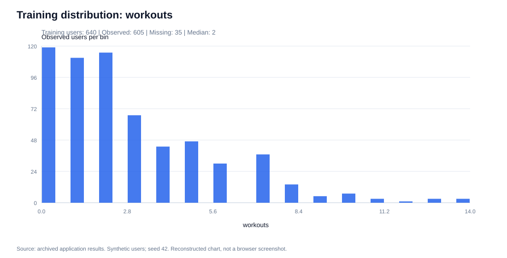
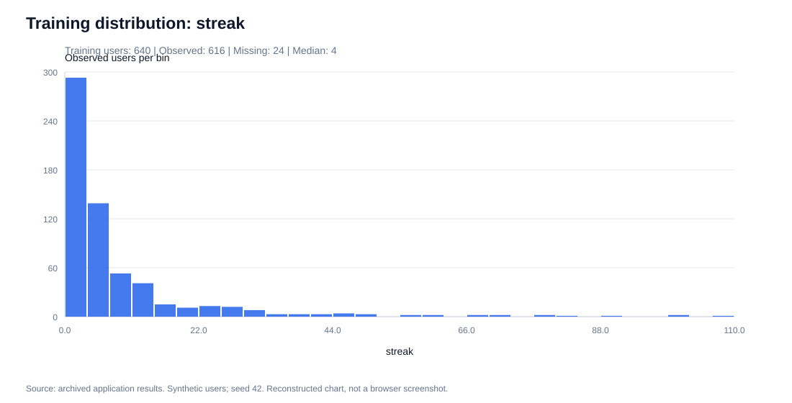
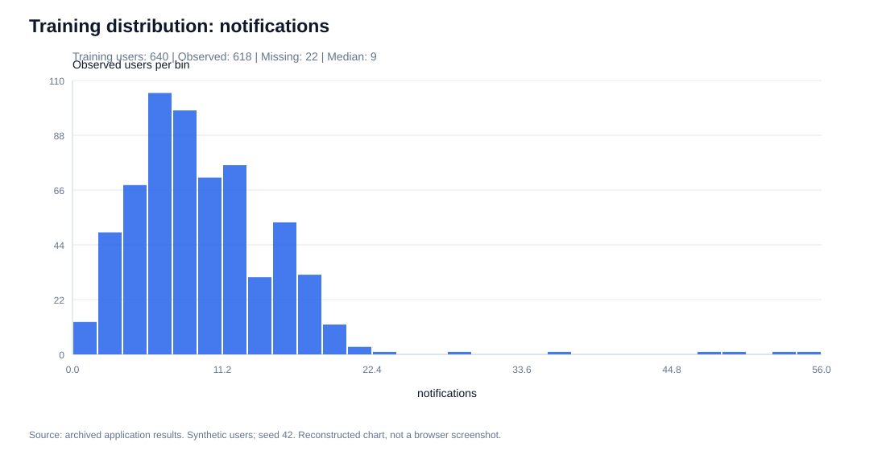
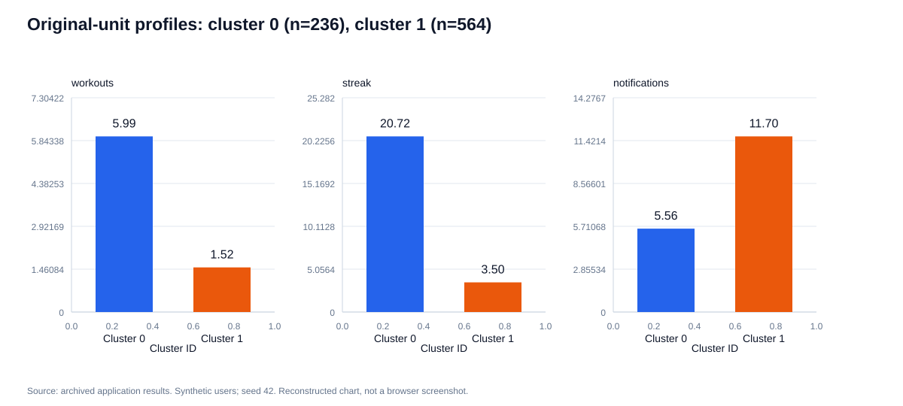
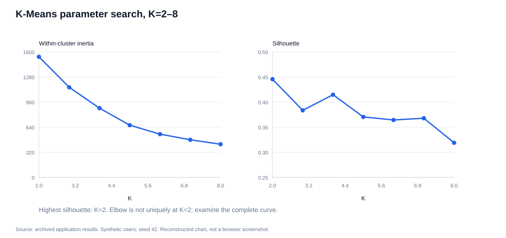
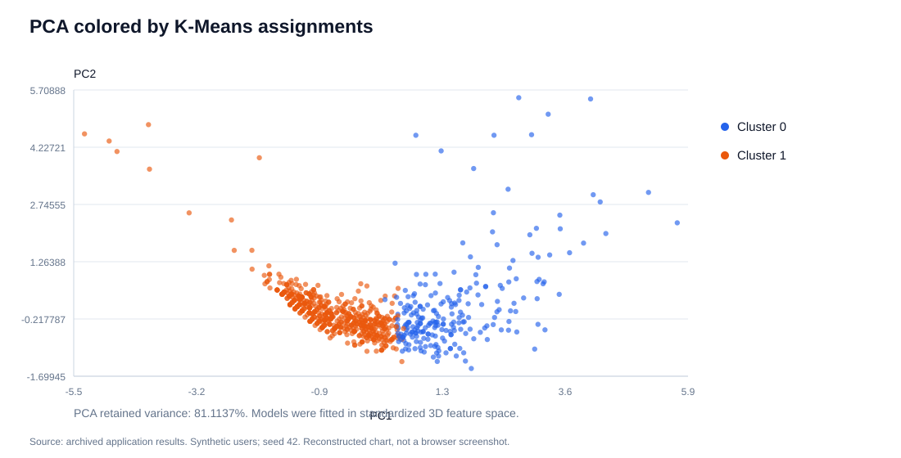
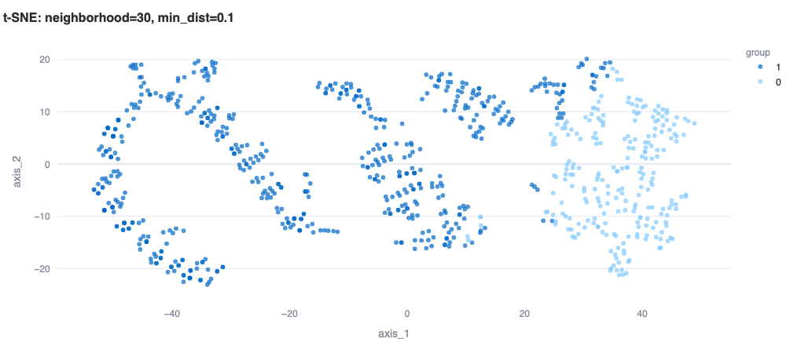
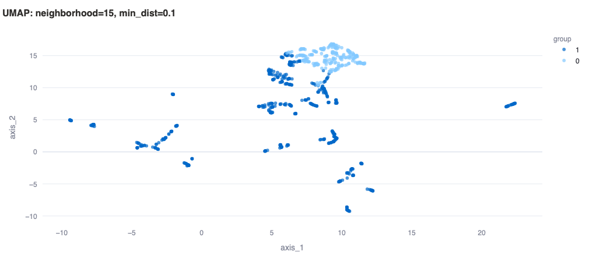
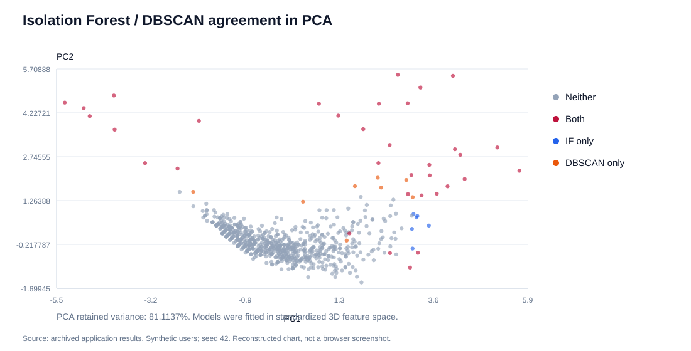

# Final Project — Unsupervised Learning Report

## Variant 28: Fitness App Retention

**Student:** Bakhtiyar Makashev Sagandykovich  
**Course:** AI Fundamentals  
**Experiment:** 800 synthetic users; seed 42; missing-value probability 0.05  
**Research question:** Which engagement groups, low-dimensional patterns, and unusual users can be identified from workouts, streak, and notifications without using next-week activity labels?

## Abstract

This project explores 800 synthetic fitness-app users using three numerical features. Median imputation and standardization were applied in a separate exploratory pipeline. K-Means evaluated K=2–8 and selected K=2 by maximum standardized silhouette of 0.4457. The resulting groups contain 236 users with higher workout/streak activity and 564 users with lower activity and more notifications. Their assignments were identical across six initialization seeds. At eps=0.7 and min_samples=5, DBSCAN identified one cluster and 42 noise points. The first two PCA components retained 81.1137% of standardized variance. Two t-SNE and two UMAP settings were inspected in the application. Isolation Forest flagged 16, 40, and 80 users at contamination 0.02, 0.05, and 0.10. At the default 0.05 setting, 34 flags overlapped with DBSCAN noise. These are complementary exploratory outputs on a simulation, not verified user categories or real anomalies.

## Step 1 — Tools, research object, and study design

The object is engagement with a fitness app. One row represents one unique user at the end of one simulated week. The three features are workout count in the preceding seven days, consecutive days of app activity (`streak`), and received push-notification count in the preceding seven days.

The analysis uses pandas/NumPy, scikit-learn KMeans, DBSCAN, PCA, TSNE, and IsolationForest, and the UMAP implementation from umap-learn. Streamlit provides controls and Plotly provides charts. The three numerical features are explicitly allowlisted. **The known target `active_next_week` and the identifier `user_id` are never supplied to preprocessing, clustering, projections, or anomaly fitting.**

The unsupervised branch analyzes the complete cohort of 800 users. It does not claim an out-of-sample test of cluster generalization. Its preprocessing objects are separate from the supervised branch, so full-cohort exploratory fitting does not alter supervised training or evaluation.

## Step 2 — Source, assumptions, feature dictionary, and quality

The data are explicitly **synthetic**. OpenML is a catalog named in the worksheet, not the origin of the observations. The generator combines overlapping engagement regimes with count and positive-valued distributions, adds unusual combinations to 3% of records, and masks feature readings independently. The regime IDs are discarded. No true segment label or true anomaly label is available for scoring these methods.

| Feature | Meaning | Unit | Observed range | Missing count |
| --- | --- | --- | --- | --- |
| workouts | Workouts over the past seven days | Count | 0–14 | 40 |
| streak | Consecutive days of app activity | Days | 0–110 | 30 |
| notifications | Push notifications received over the past seven days | Count | 0–56 | 29 |

The generator allows larger maximum values for streak and notifications than those realized in this sample. Data ranges describe observed rows, not new theoretical limits. A streak can include non-workout app activity, so it need not equal the workout count.

There are 99 missing feature cells out of 2,400 (4.125%). The original table remains unmodified, and no row is removed solely for being unusual. The analysis uses the original features without adding target-derived variables. Full-cohort median imputations are 2 workouts, 4 streak days, and 9 notifications.

## Step 3 — Three exploratory distributions

Full-cohort descriptive statistics are shown below. To keep the supervised analysis leakage-safe, the included histogram files show its training subset; they are also a transparent 640-user exploratory subset for this report, exceeding the worksheet's 100-observation minimum. The unsupervised models themselves use all 800 users.

| Feature | Full-cohort mean | Full-cohort median | Non-missing count |
| --- | --- | --- | --- |
| workouts | 2.884 | 2 | 760 |
| streak | 8.666 | 4 | 770 |
| notifications | 9.892 | 9 | 771 |

**Figure U1.** Workout counts contain many zeros and a right tail. The low-count concentration is consistent with the simulator's lower-engagement regimes.

**Figure U2.** Streak is strongly right-skewed. A small number of long streaks can influence means and distances. They should be reviewed rather than automatically classified as erroneous.

**Figure U3.** Notifications have a larger typical magnitude than workout counts. Their measurement is receipt, not opening or engagement with a push.

These distributions motivate imputation, scale comparison, and attention to tails. They do not establish ground-truth groups. The dependence structure was designed by the simulator and cannot be interpreted as an empirical discovery about a real product.

## Step 4 — Standardization and imputation sensitivity

For the primary analysis, a median imputer is followed by StandardScaler. After imputation, each feature is centered by its fitted full-cohort mean and divided by its population standard deviation. Standardization keeps a measurement with larger numerical units from dominating Euclidean distances solely because of units. It does not make the features Gaussian or eliminate outliers.

A fair preprocessing comparison holds K=2, `n_init=10`, and seed 42 fixed:

| Imputation | Scaling | Silhouette |
| --- | --- | --- |
| Median | No | 0.7283 |
| Median | Yes | 0.4457 |
| Mean | No | 0.7257 |
| Mean | Yes | 0.4339 |

The larger raw-space scores do not establish better real user segmentation. Unscaled and scaled data define different distance geometries; the streak range can dominate the raw-space result. Standardization is selected for balanced feature contributions rather than by choosing whichever geometry produces the largest silhouette. Median scaling also gives slightly higher silhouette than mean scaling in this run, consistent with sensitivity to the tails. This is a local methodological comparison, not a universal rule that median imputation is always superior.

## Step 5 — K-Means clustering and centroid interpretation

K-Means iterates between assigning each point to its nearest centroid and recomputing each centroid as the arithmetic mean of its assigned points. The fit is performed in standardized **three-dimensional feature space**, not in PCA, t-SNE, or UMAP coordinates.

The chosen fit has K=2, `n_init=10`, seed 42, and inertia 1537.9423. Inertia is the sum of squared distances to assigned centroids. It is a within-cluster objective, not accuracy and not evidence of correct labels.

| Cluster ID | Users | Share | Mean workouts | Mean streak | Mean notifications | Descriptive name |
| --- | --- | --- | --- | --- | --- | --- | --- |
| 0 | 236 | 29.5% | 5.987 | 20.723 | 5.555 | Higher engagement |
| 1 | 564 | 70.5% | 1.521 | 3.499 | 11.702 | Lower engagement, more notifications |

**Figure U4.** Original-unit cluster means calculated over observed values. Each panel uses its own unit; bars across panels should not be treated as directly comparable magnitudes.

The profile means exclude missing observations and therefore are not exactly the same as inverse-transformed centroids computed on imputed data. User counts include all assigned users. The numerical IDs have no ordinal or semantic meaning.

An initial product hypothesis is that the lower-engagement group could benefit from opt-in support or different onboarding, while the higher-engagement group might value continuity and personalized goals. More notifications in the lower-engagement group may reflect targeting policy or the generator rather than harm caused by notifications. The proposed actions need prospective validation and randomized experiments.

## Step 6 — K selection, elbow, silhouette, and stability

| K | Inertia | Silhouette |
| --- | --- | --- |
| 2 | 1537.9423 | 0.4457 |
| 3 | 1149.2276 | 0.3836 |
| 4 | 883.3511 | 0.4148 |
| 5 | 666.1989 | 0.3705 |
| 6 | 551.6086 | 0.3644 |
| 7 | 479.8398 | 0.3679 |
| 8 | 422.9663 | 0.3190 |

**Figure U5.** The elbow curve decreases throughout the tested range; there is no uniquely compelling elbow at K=2. The inertia reduction becomes smaller after approximately K=4–5. Silhouette instead peaks at K=2, while K=4 is a secondary candidate.

K=2 is retained as the primary coarse segmentation because it has the highest silhouette and simple, interpretable activity profiles. This choice is supported mainly by silhouette and interpretability; the elbow provides a complementary picture and does not independently confirm K=2. Inertia alone cannot choose K because adding centroids generally reduces it. A richer K=4 solution would require separate profile and stability interpretation rather than being declared incorrect.

For K=2, fits with seeds 0, 1, 2, 3, 4, and 42 all yielded silhouette 0.4457, essentially identical inertia, and ARI=1.0 versus the reference fit. The mean pairwise ARI is also 1.0. ARI compares partitions without depending on their numerical IDs. This is strong initialization stability on this cohort under `n_init=10`. It does not demonstrate stability under resampling, changing scales, new time periods, or a different data generator.

## Step 7 — DBSCAN and parameter sensitivity

DBSCAN connects dense neighborhoods using `eps` and `min_samples`, labeling sparse or disconnected observations as noise (`-1`). Its result depends on both settings and on the standardized geometry.

| eps | min_samples | Clusters excluding noise | Noise users | Noise share | Silhouette excluding noise |
| --- | --- | --- | --- | --- | --- |
| 0.4 | 3 | 9 | 79 | 9.875% | 0.0858 |
| 0.4 | 5 | 2 | 110 | 13.750% | 0.3601 |
| 0.4 | 8 | 1 | 133 | 16.625% | Not defined |
| 0.7 | 3 | 3 | 32 | 4.000% | 0.6125 |
| 0.7 | 5 | 1 | 42 | 5.250% | Not defined |
| 0.7 | 8 | 1 | 49 | 6.125% | Not defined |
| 1.0 | 3 | 4 | 8 | 1.000% | 0.6373 |
| 1.0 | 5 | 2 | 21 | 2.625% | 0.7652 |
| 1.0 | 8 | 1 | 29 | 3.625% | Not defined |

At the exported default, eps=0.7 and min_samples=5, **758 users form one cluster and 42 are noise**. Standard silhouette is undefined after excluding noise because only one cluster remains; the blank CSV value is intentional, not a failed calculation. Noise is excluded rather than treated as an ordinary second cluster.

At fixed min_samples, larger eps reduces the noise count in this grid, while cluster counts change as dense regions emerge or merge. At fixed eps, larger min_samples increases the observed noise count. The high silhouette at eps=1.0/min_samples=5 is conditional on its retained non-noise subset and two-cluster solution. It should not be used as an automatic winner over K-Means or settings with different excluded observations. The default analysis does not establish several robust density-separated user groups.

## Step 8 — PCA, variance, and loadings

PCA is fitted without the target on the median-imputed standardized feature matrix. It gives orthogonal directions of decreasing variance.

| Component | Explained variance | Cumulative variance |
| --- | --- | --- |
| PC1 | 56.8283% | 56.8283% |
| PC2 | 24.2854% | 81.1137% |
| PC3 | 18.8863% | 100.0000% |

| Component direction | workouts | streak | notifications |
| --- | --- | --- | --- |
| PC1 | +0.6165 | +0.5479 | −0.5654 |
| PC2 | −0.0676 | +0.7523 | +0.6554 |

**Figure U6.** Archived PCA coordinates colored by the original K=2 assignments; no fitting or relabeling was performed for this reconstruction.

PC1 contrasts workout/streak engagement with received-notification volume. PC2 is dominated by streak and notifications in the displayed orientation. Component signs are arbitrary: reversing a PC axis does not change its information. These coefficients describe variance directions, not causal effects. The first two components retain 81.1137% of standardized variance and discard 18.8863%; overlap in this view does not prove overlap in all original dimensions.

## Step 9 — t-SNE and sensitivity

t-SNE is used only as a nonlinear visualization, with PCA initialization, `learning_rate="auto"`, `max_iter=1000`, seed 42, and perplexity settings 30 and 10. Colors come from the unchanged K=2 labels fitted in standardized 3D space. Target labels are not used.

The application's prior browser demonstration recorded trustworthiness(k=10) of **0.9959** at perplexity 30 and **0.9949** at perplexity 10. These values were initially observed in the browser and have now been reproduced exactly by executing the supplemental standalone unsupervised notebook on the same archived rows. The new `unsupervised_outputs/projection_diagnostics.csv` preserves them; they were not fields in the original ZIP. They indicate strong local-neighborhood preservation for this simulated cohort and metric. Their small difference should not be promoted into a significant algorithm comparison.

The layouts at the two settings need not occupy the same positions or show the same island shapes. Absolute distances between t-SNE islands, their areas, and the apparent number of groups are not reliable estimates of original-space geometry. A plot should illustrate neighborhood patterns, not become an unvalidated clustering result.

**Figure U8.** Direct PNG export from the running application's t-SNE chart, perplexity=30 and seed=42. The chart's generic title displays `min_dist=0.1`, but min_dist is not a t-SNE parameter. The supplemental notebook uses the clearer title “t-SNE: perplexity=30” and saves coordinates for perplexities 30 and 10. The broad color transition is consistent with the coarse K-Means partition, while the islands themselves are not verified user classes.

## Step 10 — UMAP and comparison of projections

UMAP was inspected with n_neighbors=15 and 30, min_dist=0.1, seed 42, and n_jobs=1. As with PCA and t-SNE, no target was passed to fitting. Neighborhood size changes the balance between very local and broader structure, while min_dist influences how tightly the map packs points.

| Projection / setting | Trustworthiness(k=10) | Evidence origin |
| --- | --- | --- |
| t-SNE, perplexity=30 | 0.9959 | Browser and executed notebook |
| t-SNE, perplexity=10 | 0.9949 | Browser and executed notebook |
| UMAP, n_neighbors=15, min_dist=0.1 | 0.9909 | Browser and executed notebook |
| UMAP, n_neighbors=30, min_dist=0.1 | 0.9870 | Browser and executed notebook |

The UMAP maps were successfully computed in the application and reproduced in the supplemental notebook with the same trustworthiness diagnostics. Their neighborhood preservation is high under this measure, but trustworthiness is not cluster accuracy, causal evidence, or proof of better global geometry. The analysis varies n_neighbors; it does not establish robustness across all min_dist settings or random seeds. Exact layouts depend on implementation, versions, and randomness.

PCA is the most straightforward primary plot for this report because its variance coverage and loading directions are explicitly quantified. t-SNE and UMAP are useful complementary local-neighborhood views. There is no universal requirement that a nonlinear map look more separated, nor should its visual separation be used as independent validation of the K-Means groups that supply its colors.

**Figure U9.** Direct PNG export from the running app, n_neighbors=15, min_dist=0.1, seed=42. The map displays localized regions and a broad engagement-related color pattern. Its separated visual pieces do not independently establish additional clusters. Coordinates for n_neighbors=15 and 30 are saved in the supplemental notebook outputs; the notebook displays both maps and their diagnostics.

## Step 11 — Isolation Forest, contamination, and DBSCAN overlap

Isolation Forest uses random partitions to identify points that are easy to isolate. The application fits 200 trees with the fixed seed and varies contamination. The decision function is lower for more unusual records; negative values fall beyond the fitted flagging threshold.

| Contamination | Flagged observations | Observed share |
| --- | --- | --- |
| 0.02 | 16 | 2% |
| 0.05 | 40 | 5% |
| 0.10 | 80 | 10% |

Contamination sets an expected flagging fraction through a threshold; it is not a measured true anomaly prevalence. Under fixed data and seed in this implementation, changing contamination mainly changes the cutoff rather than creating evidence that the anomaly population doubled.

At contamination 0.05 and default DBSCAN settings, the saved masks produce:

| Comparison category | Users |
| --- | --- |
| Flagged by both methods | 34 |
| Isolation Forest only | 6 |
| DBSCAN noise only | 8 |
| Neither | 752 |
| Union of all flags | 48 |
| Total disagreement | 14 |

Jaccard overlap is `34/48=0.7083`; 85% of IF flags overlap DBSCAN noise, and 80.95% of DBSCAN noise overlaps IF flags. These are agreement measures without a true anomaly label, not precision or recall of actual anomalies.

**Figure U7.** Archived PCA positions colored by the two saved anomaly masks. Agreement reflects two complementary definitions of unusual behavior, not independent confirmation that a point is erroneous.

DBSCAN identifies low-density observations relative to neighbors; IF uses isolation under random splits. A user can be sparse locally without being globally easy to isolate, or unusual in combinations that differ between the methods. Before acting on a flag, check the original event records and time zones, then investigate plausible behavior, device synchronization, duplicate events, or notification policies. Do not automatically delete rows or block accounts. The generator's 3% unusual-record insertion does not establish ground-truth detection accuracy; those insertion identities were not exported as labels.

## Step 12 — Synthesis, practical value, limitations, and conclusion

The combined summary joins user IDs, original feature values, K-Means labels, DBSCAN labels, IF flags/scores, and PCA coordinates. The exported target is present only for audit and is not part of unsupervised model fitting. Profiles can support hypotheses about differentiated product support, while anomaly masks can prioritize manual record review. A segment name should not be treated as a diagnosis of motivation or future churn.

K-Means gives a stable **coarse two-group description** of this synthetic cohort. DBSCAN's default output is instead one broad dense region plus sparse observations. These findings can coexist: K-Means must divide all points into a requested number of centroid groups, whereas DBSCAN has a density criterion and may leave observations unassigned. PCA shows that a 2D display retains most, but not all, standardized variance. The nonlinear maps preserve local neighborhoods well under the observed trustworthiness diagnostic without establishing true categories.

The major limits are synthetic provenance, assumptions about missingness, sensitivity to distance geometry, lack of verified segment/anomaly labels, and the absence of resampling or temporal generalization checks. Initialization stability is narrower than full robustness. Long tails and unusual combinations may be artifacts of the generator. Proposed improvements are real consented logs, validation of event definitions, bootstrapped cluster stability with label-invariant agreement, alternative robust scaling, comparisons across future periods, external review of unusual records, and randomized tests of any segment-specific campaign.

This study analyzed 800 simulated users and three numerical features. Median-imputed standardized K-Means favored K=2 by silhouette 0.4457, with interpretable 236/564-user profiles. DBSCAN at eps=0.7/min_samples=5 found one group and 42 noise records. PC1 and PC2 retained 81.1137% of standardized variance. IF at contamination 0.05 flagged 40 records, with 34 overlapping DBSCAN noise. The methods form a complementary exploratory toolkit, while none independently establishes real user types, causal effects, or verified anomalies.

## Worksheet questions and answers

**1. Why must the known target be excluded?** Including next-week activity would change the distance geometry using the outcome being studied and contaminate an exploratory analysis intended to use only current behavior. The explicit feature allowlist prevents this.

**2. How did scaling change distance-based results?** For median imputation at K=2, silhouette changed from 0.7283 in raw units to 0.4457 after standardization. Raw streak magnitudes can dominate distances. These scores refer to different spaces; the higher raw value is not proof of superior real categories.

**3. What evidence supports K?** K=2 has the maximum standardized silhouette, simple higher/lower engagement profiles, and ARI=1 across tested initialization seeds. The elbow is not uniquely supportive of K=2 and suggests considering diminishing returns around K=4–5. K=2 is a parsimonious choice, not a discovered universal truth.

**4. How sensitive is DBSCAN?** Across the tested grid it yields 1–9 clusters and 8–133 noise users. At the default it gives one cluster plus 42 noise users; at eps=1.0/min_samples=5 it gives two clusters plus 21 noise users. Parameter sensitivity is substantial.

**5. How much variance does PCA retain, and what do t-SNE/UMAP fail to preserve?** Two PCs retain 81.1137%. Nonlinear maps emphasize local neighborhood relationships but do not faithfully preserve every global distance, group area, relative position, or apparent cluster count.

**6. Where do anomaly methods agree and disagree?** They share 34 flags at the default settings. IF alone flags 6 users and DBSCAN alone flags 8; 14 assignments disagree. The Jaccard overlap is 0.7083. This is agreement, not ground-truth accuracy.

**7. What are two important limitations?** First, simulated observations cannot validate real retention behavior. Second, initialization stability and attractive 2D maps do not establish stable segments in new users or future weeks. Additional limits include MCAR simplification and no verified anomaly labels.

**8. Why is inertia not accuracy, and what is a centroid?** A centroid is the mean of assigned feature vectors in the fitted space. Inertia sums squared distances to these means. Without true classes it cannot count correct predictions, and it typically falls as K increases.

**9. What should be checked before calling a flag a real anomaly?** Verify source events and collection/synchronization issues, then seek a plausible behavioral or operational explanation. Independent review or labeled investigation is needed before claiming an error or fraud.

## Evidence and submission note

The K tables, profiles, PCA values, and default anomaly agreement are directly supported by archived CSVs. The original ZIP lacked t-SNE/UMAP images and coordinates. Figures U8–U9 now include direct application PNG exports. The [standalone unsupervised notebook](../notebooks/Fitness_Retention_Unsupervised.ipynb), executed locally in the project environment, reproduces the diagnostics and saves all four embedding coordinate files. It can be uploaded to Google Colab; no Google-hosted execution is claimed. The published notebook opens directly through this verified [Google Colab link](https://colab.research.google.com/github/bahti2009-droid/fitness-retention-variant28/blob/main/notebooks/Fitness_Retention_Unsupervised.ipynb).

## References

1. *Final Project — Unsupervised Learning*, supplied course handout, Variant 28 and its 12-step example.
2. The application's `fitness_results_SYNTHETIC.zip`, including original data, summary, PCA loadings, sensitivity tables, and manifest.
3. Source functions in `app.py`: `prepare`, `unsupervised`, `fit_kmeans`, `density_analysis`, `nonlinear_projection`, `anomaly_analysis`.
4. [scikit-learn: Clustering](https://scikit-learn.org/stable/modules/clustering.html).
5. [scikit-learn: Novelty and Outlier Detection](https://scikit-learn.org/stable/modules/outlier_detection.html).
6. [UMAP: Reproducibility](https://umap-learn.readthedocs.io/en/latest/reproducibility.html).
